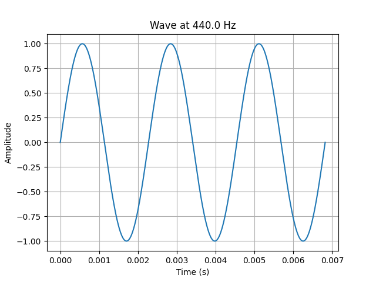

# Week 1: Wave Basics

How frequency, period and wavelength are related for a sound wave.



*Three cycles of a 440 Hz wave, as drawn by `wave_calculator.py`.*

## Key formulas

| Quantity | Formula |
|---|---|
| Period | T = 1 / f |
| Wave speed | v = f × λ |
| Wavelength | λ = v / f |

The speed of sound is taken as **343 m/s**.

## Files

| File | What it does |
|---|---|
| `wave_calculator.py` | You type in any known value (frequency, period or wavelength). It calculates the others and plots 3 cycles. |
| `homework_wave_problems.py` | Six wave problems solved in code. |

## How to run

```bash
pip install numpy matplotlib
python wave_calculator.py
```

Leave a question blank by pressing Enter. Example with 440 Hz:

```
[Result] Frequency: 440.00000 Hz
[Result] Period: 0.00227 seconds
[Result] Wavelength: 0.77955 meters
```

## Homework results

| Question | Answer |
|---|---|
| 1. Velocity (λ = 1.5 m, f = 220 Hz) | 330 m/s |
| 2. Period 0.004 s | 250 Hz, audible |
| 3. Vibrations in 5 s (v = 340 m/s, λ = 2 m) | 850 |
| 4. Original frequency | 150.88 Hz |
| 5. Frequencies of the two waves | 250 Hz and 125 Hz |
| 6. Velocity | Cannot be solved: a frequency value is missing |

## What I learned

- Higher frequency means a shorter period and a shorter wavelength.
- Audible sound for humans is about 20 Hz to 20,000 Hz.
