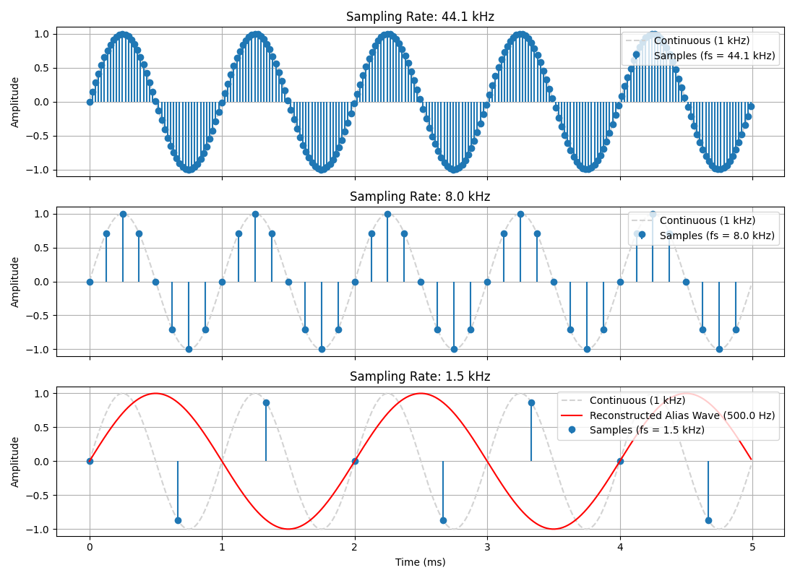

# Week 2: Sampling, Nyquist Criterion and Aliasing

What happens when a 1 kHz sine wave is sampled too slowly.



*Grey dashed line: the real 1 kHz wave. Blue dots: the samples. Red line: the false wave that appears when sampling is too slow.*

## The idea

To record a signal correctly, the sampling rate must be **at least twice** its highest frequency (the Nyquist rate). Below that, the signal shows up as a lower, false frequency. This is called **aliasing**.

For a 1 kHz signal the Nyquist rate is 2 kHz.

## Results

| Sampling rate | Nyquist criterion | Result |
|---|---|---|
| 44.1 kHz | Satisfied | Wave is captured correctly |
| 8 kHz | Satisfied | Wave is captured correctly |
| 1.5 kHz | **Violated** | Looks like a **500 Hz** wave (alias) |

Alias frequency: `f_alias = |f_signal − k × fs|`, where k is the multiple of fs closest to f_signal. Here `|1000 − 1 × 1500| = 500 Hz`.

## Files

| File | What it does |
|---|---|
| `sampling_nyquist_aliasing.py` | Draws a near-continuous 1 kHz wave, samples it at three rates, checks the Nyquist criterion and plots the alias. |

## How to run

```bash
pip install numpy matplotlib
python sampling_nyquist_aliasing.py
```

## What I learned

- A higher sampling rate than the minimum is safe. A lower one gives a wrong signal that cannot be fixed afterwards.
