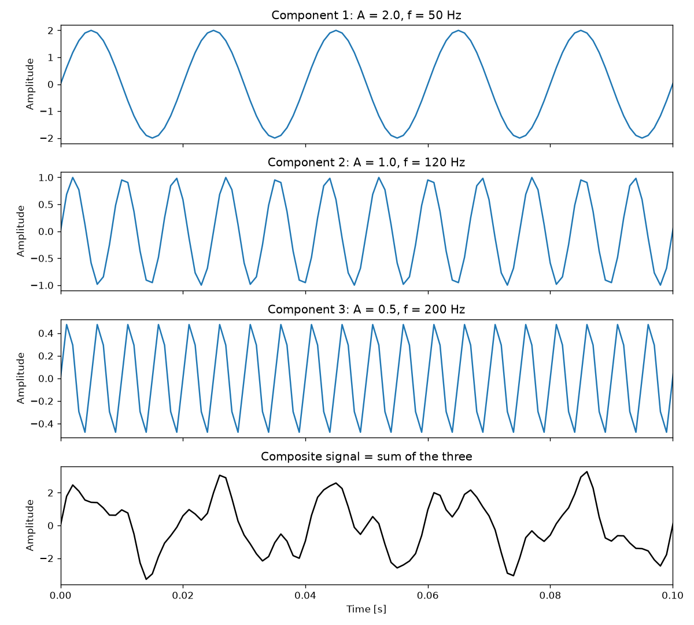
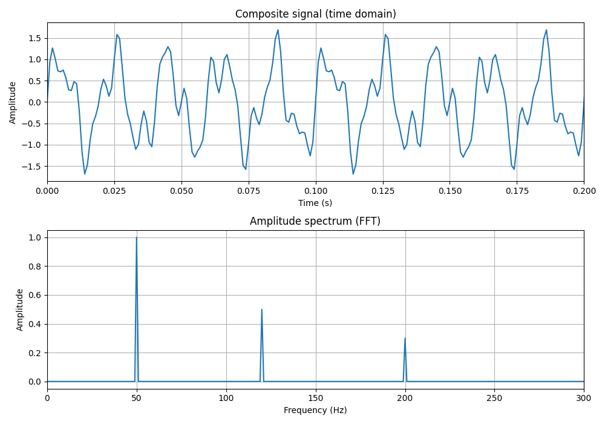

# Week 3: Composite Signals and the FFT

Build a signal by adding three sine waves, then use the FFT to find them again.



*Top three plots: the individual sine waves. Bottom plot: their sum (the first 0.1 s).*

## Spectrum from the homework



*The FFT shows three peaks, one for each sine wave.*

## Results

| Component | Frequency | Amplitude found by the FFT |
|:---:|:---:|:---:|
| 1 | 50 Hz | 1.000 |
| 2 | 120 Hz | 0.500 |
| 3 | 200 Hz | 0.300 |

These match the values used to build the signal.

## Files

| File | What it does |
|---|---|
| `composite_signal_generation.py` | Builds a signal from 3 sine waves (50, 120 and 200 Hz) and saves a plot. |
| `composite_signal_fft_homework.py` | Takes the FFT of a composite signal, finds the peaks and prints each frequency and amplitude. |
| `figures/` | Plots made by the scripts. |

## How to run

```bash
pip install numpy matplotlib
python composite_signal_fft_homework.py
```

## Notes

- Sampling rate: 1000 Hz.
- The FFT values are multiplied by 2/N so each peak equals the amplitude of its sine wave.
- Peaks below 0.05 are ignored as noise or leakage.

## What I learned

- A complicated-looking signal is a sum of simple sine waves, and the FFT separates them.
