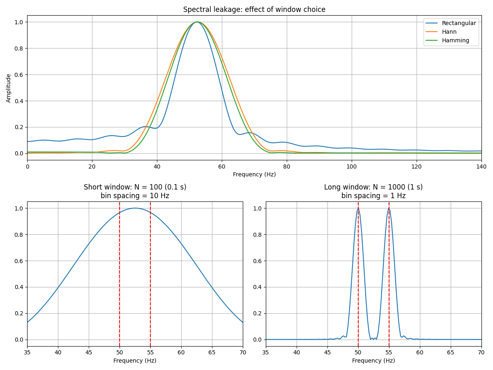

# Week 4: Spectral Leakage and Frequency Resolution

How the window and the signal length change an FFT result, using two close tones (50 Hz and 55 Hz).



## What the plots show

**Top: window choice.** The rectangular window leaks energy into nearby frequencies (side lobes). Hann and Hamming leak less.

**Bottom left: short signal (100 samples, 0.1 s).** Bin spacing is 10 Hz, so the two tones merge into one wide peak.

**Bottom right: long signal (1000 samples, 1 s).** Bin spacing is 1 Hz, so the two tones separate. Red dashed lines mark 50 Hz and 55 Hz.

## Key points

| Idea | What I found |
|---|---|
| Window choice | Hann and Hamming reduce leakage compared with the rectangular window |
| Frequency resolution | Set by the signal length: bin spacing = fs / N |
| Zero-padding (n = 4096) | Makes the curve look smooth. It does **not** make close tones separate |

## Files

| File | What it does |
|---|---|
| `fft_spectral_leakage_resolution.py` | Compares three windows, then short and long signals, and plots both. |

## How to run

```bash
pip install numpy matplotlib
python fft_spectral_leakage_resolution.py
```

## What I learned

- To tell two close frequencies apart, record the signal for longer. Padding or a different window will not do it.
